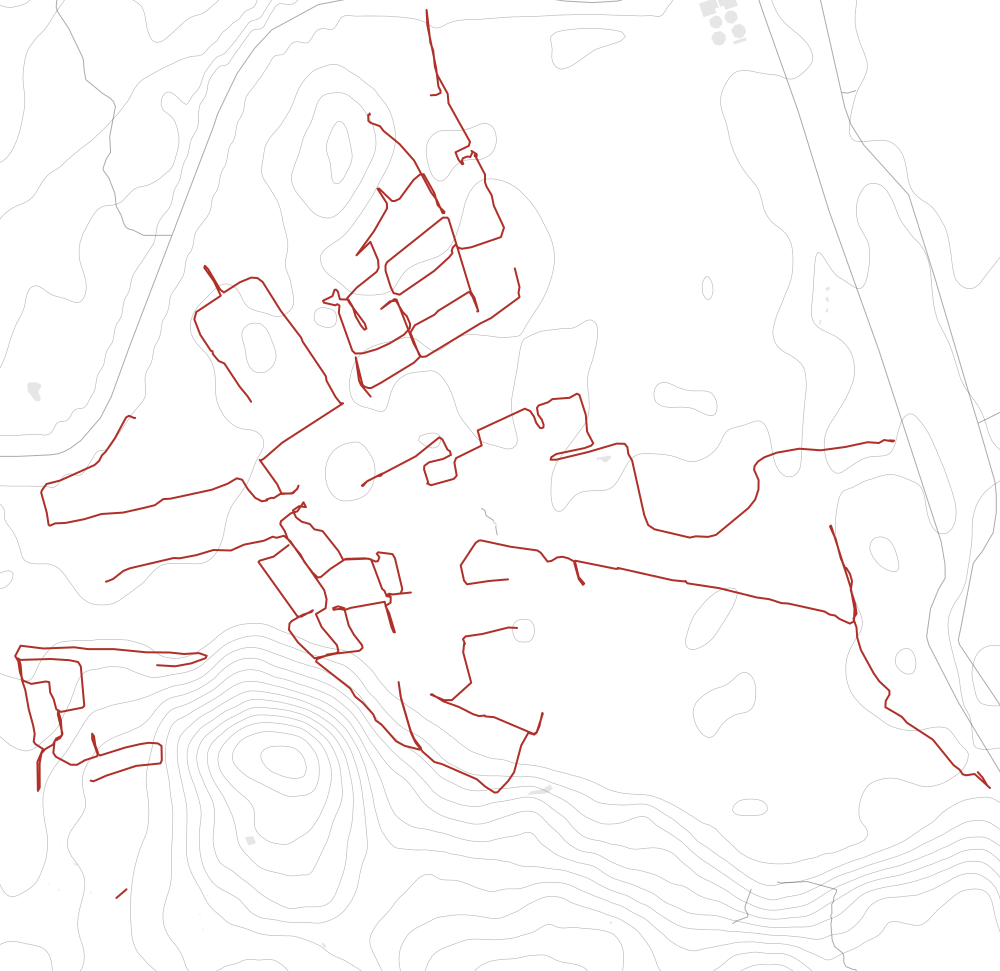

ai engineer @ fhnw institute for data science. previously cto & co-founder of studyflash. builds applied ai/ml systems with industry partners.

every street of zuchwil — 46.5 km over six runs. the interactive version is on <a href="https://barbisch.me">barbisch.me</a>
