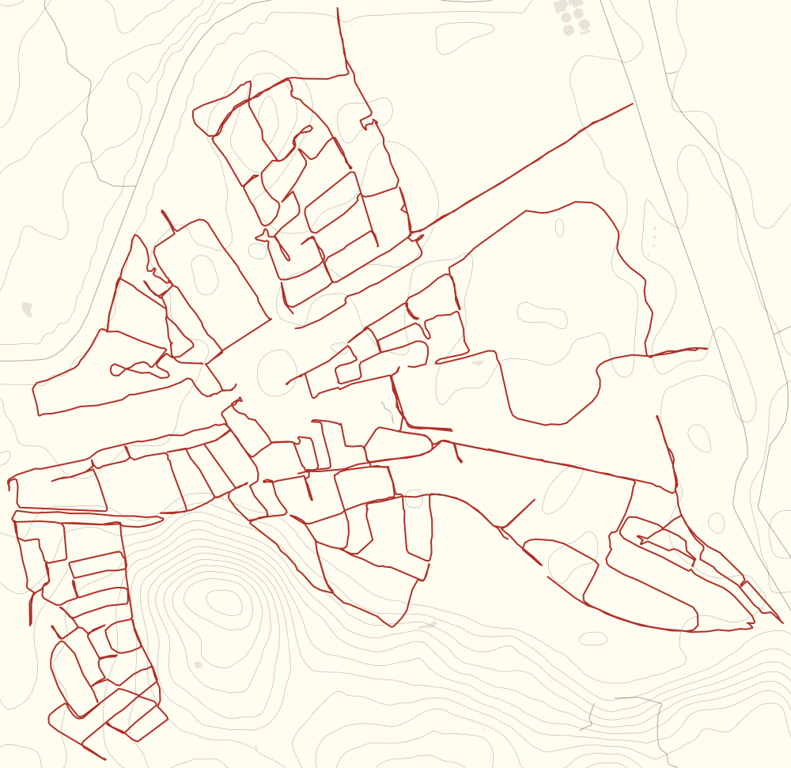

ai engineer @ fhnw institute for data science. previously cto & co-founder of studyflash. builds applied ai/ml systems with industry partners.

<picture>
  <source media="(prefers-color-scheme: dark)" srcset="everystreet-dark.svg">
  
</picture>

every street of zuchwil — 46.5 km over six runs. the animated version is on <a href="https://barbisch.me">barbisch.me</a>
